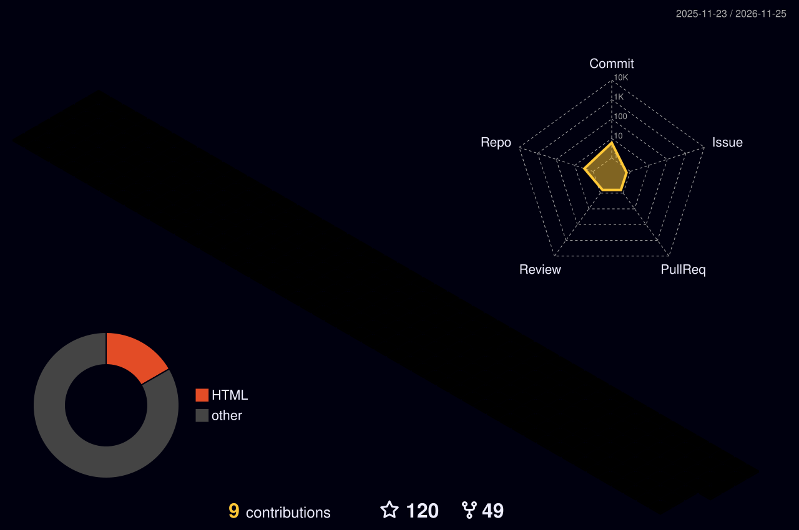

  <!-- 1. HERO VIEWFINDER -->
  

    

  <!-- 2. WHAT I BUILD & HOBBIES CAROUSEL -->
  

    

  <!-- 3. TECH STACK ORBIT -->
  

    

  <!-- 4. HOLOGRAPHIC ID BADGE & ENGINEERING DASHBOARD -->
  

    

---

### 🚀 Featured Architectural Solutions & Projects

| Project | Domain / Architecture | Tech Stack | Status |
| :--- | :--- | :--- | :---: |
| **Enterprise Cloud Gateway** | High-throughput distributed API gateway with rate limiting & JWT session pooling | `Java 21` `Spring Boot` `Docker` `Redis` | `Production` |
| **Reactive Real-time Portal** | Fluid modern web application with real-time state synchronization & reactive UI | `TypeScript` `React` `Next.js` `Tailwind` | `Active` |
| **Cloud-Native Cluster Pipeline** | Automated CI/CD deployment pipeline with containerized Kubernetes workloads | `Kubernetes` `Docker` `GitHub Actions` `Helm` | `Automated` |
| **Distributed Microservice Core** | Event-driven backend service architecture handling high concurrency transactions | `Python 3` `PostgreSQL` `gRPC` `REST` | `Production` |

---

  <!-- 5. 3D NIGHT CONTRIBUTION SKYLINE -->
  

    

  <!-- 6. CONNECT & TRANSMISSION FOOTER -->
  

   

  <!-- Direct Link Pills -->
  

    
    &nbsp;&nbsp;
    
    &nbsp;&nbsp;
    
  

  Crafted with midnight-glass design, pure SVG + CSS/SMIL animations • Zero client-side JavaScript • Refreshed dynamically

